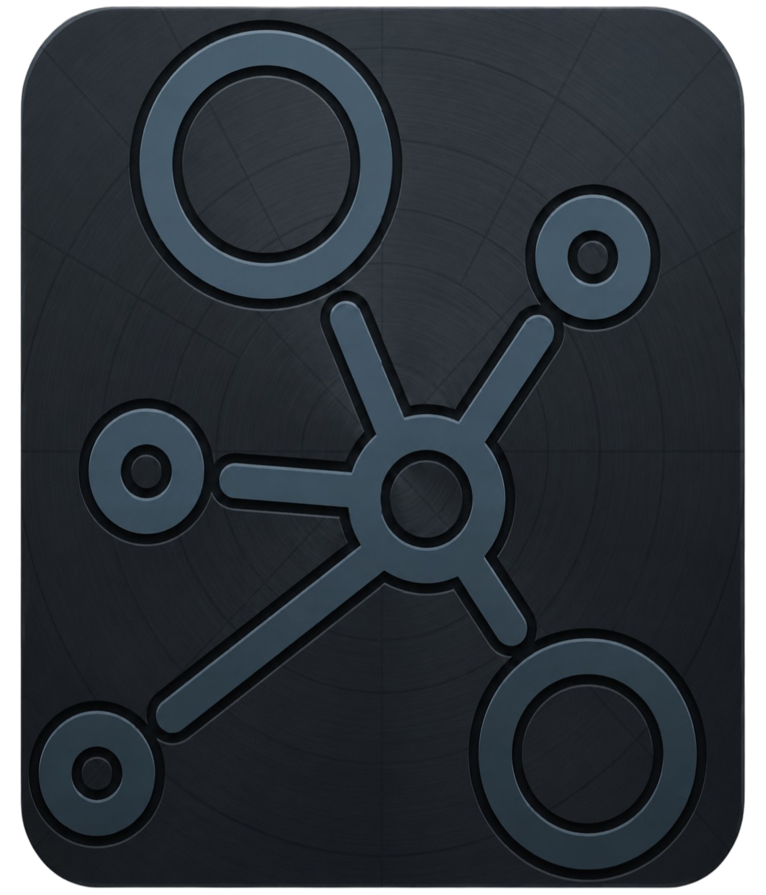

<h1>
  
  Linka
</h1>

[](https://github.com/Org-Linka/linka/releases)
[](https://github.com/Org-Linka/linka/tags)
[](https://expo.dev/)
[](https://reactnative.dev/)
[](https://supabase.com/)

O **Linka** é uma aplicação mobile desenvolvida com **Expo**, **React Native** e **Supabase**, criada para centralizar fluxos relacionados a usuários, perfis, projetos, cursos, eventos, oportunidades e demais funcionalidades da plataforma.

O projeto utiliza uma organização modular por funcionalidades, com foco em manter o código previsível, escalável e fácil de revisar.

---

## Sumário

- [Sobre o projeto](#sobre-o-projeto)
- [Status do projeto](#status-do-projeto)
- [Tecnologias](#tecnologias)
- [Funcionalidades previstas](#funcionalidades-previstas)
- [Estrutura geral](#estrutura-geral)
- [Pré-requisitos](#pré-requisitos)
- [Como rodar localmente](#como-rodar-localmente)
- [Variáveis de ambiente](#variáveis-de-ambiente)
- [Scripts disponíveis](#scripts-disponíveis)
- [Documentação](#documentação)
- [Contribuição](#contribuição)
- [Segurança](#segurança)
- [Licença](#licença)

---

## Sobre o projeto

O Linka tem como objetivo servir como base para uma aplicação organizada, com separação clara entre telas, regras de negócio, integrações externas, validações e tipos.

A aplicação é construída com:

- **Expo Router** para rotas e navegação;
- **React Native** para interface mobile;
- **Supabase** como backend principal;
- **TypeScript** para tipagem estática;
- **Zod** para validações;
- **NativeWind / Tailwind CSS** para estilização;
- **OneSignal / Expo Notifications** para notificações;
- **EAS Build** para builds e distribuição.

---

## Status do projeto

O projeto está em desenvolvimento ativo.

A versão atual do app está definida como `v0.1.0`, porém o produto ainda pode receber alterações estruturais, ajustes de funcionalidades e melhorias de documentação até atingir uma versão considerada estável.

Consulte o histórico de mudanças em:

- [Changelog](docs/CHANGELOG.md)
- [Releases](https://github.com/Org-Linka/linka/releases)
- [Tags](https://github.com/Org-Linka/linka/tags)

---

## Tecnologias

| Área | Tecnologia |
|---|---|
| Mobile | Expo |
| Interface | React Native |
| Rotas | Expo Router |
| Backend | Supabase |
| Banco de dados | PostgreSQL via Supabase |
| Validação | Zod |
| Tipagem | TypeScript |
| Estilização | NativeWind / Tailwind CSS |
| Notificações | OneSignal e Expo Notifications |
| Build | EAS Build |
| Qualidade | ESLint e TypeScript |

---

## Funcionalidades previstas

As funcionalidades podem evoluir conforme as issues e releases do projeto.

Escopos principais planejados ou em desenvolvimento:

- Autenticação de usuários;
- Perfil de usuário;
- Projetos;
- Cursos;
- Eventos;
- Oportunidades;
- Notificações;
- Upload e uso de imagens;
- Integração com Supabase;
- Organização por permissões e regras de acesso;
- Melhorias futuras de analytics e pagamentos, se forem necessárias ao produto.

---

## Estrutura geral

A estrutura principal do código fica dentro de `src`.

```txt
src/
├── app/
├── features/
├── shared/
└── config/
````

Resumo das pastas:

| Pasta          | Responsabilidade                                            |
| -------------- | ----------------------------------------------------------- |
| `src/app`      | Rotas do Expo Router                                        |
| `src/features` | Funcionalidades organizadas por domínio                     |
| `src/shared`   | Componentes, hooks, libs, tipos e utilitários reutilizáveis |
| `src/config`   | Configurações globais do projeto                            |

A explicação completa da arquitetura está em:

* [Arquitetura do projeto](docs/ARCHITECTURE.md)

---

## Pré-requisitos

Antes de rodar o projeto, tenha instalado:

* Node.js;
* npm;
* Git;
* Expo CLI, se preferir usar comandos globais;
* Android Studio, caso vá rodar em emulador Android;
* Xcode, caso vá rodar em iOS/macOS;
* Conta e projeto configurado no Supabase.

---

## Como rodar localmente

Clone o repositório:

```bash
git clone https://github.com/Org-Linka/linka.git
```

Entre na pasta do projeto:

```bash
cd linka
```

Instale as dependências:

```bash
npm install
```

Crie o arquivo `.env` com base no exemplo:

```bash
cp .env.example .env
```

Preencha as variáveis necessárias no `.env`.

Inicie o projeto:

```bash
npm start
```

Para rodar diretamente em plataformas específicas:

```bash
npm run android
```

```bash
npm run ios
```

```bash
npm run web
```

---

## Variáveis de ambiente

O projeto usa um arquivo `.env` local para configurar informações públicas necessárias ao app.

Use o arquivo `.env.example` como base.

Principais variáveis:

```env
EXPO_PUBLIC_APP_NAME=Linka
EXPO_PUBLIC_APP_ENV=development

EXPO_PUBLIC_SUPABASE_URL=https://your-project-ref.supabase.co
EXPO_PUBLIC_SUPABASE_ANON_KEY=your-supabase-anon-public-key
```

Variáveis prefixadas com `EXPO_PUBLIC_` são expostas ao app cliente. Portanto, use esse prefixo apenas para valores públicos e seguros.

Nunca coloque no frontend:

* Senhas;
* Tokens privados;
* Chaves administrativas;
* Supabase `service_role key`;
* Credenciais de banco de dados;
* Segredos de gateways de pagamento;
* Arquivos `.env` reais.

---

## Scripts disponíveis

| Comando                         | Descrição                                   |
| ------------------------------- | ------------------------------------------- |
| `npm start`                     | Inicia o projeto com Expo                   |
| `npm run android`               | Executa o app no Android                    |
| `npm run ios`                   | Executa o app no iOS                        |
| `npm run web`                   | Executa o app no navegador                  |
| `npm run lint`                  | Roda o ESLint em `src`                      |
| `npm run typecheck`             | Executa verificação de tipos com TypeScript |
| `npm run generate-brand-assets` | Gera assets de marca do projeto             |
| `npm run reset-project`         | Executa o script de reset do projeto        |

Antes de abrir um Pull Request, rode pelo menos:

```bash
npm run lint
npm run typecheck
```

---

## Documentação

A documentação principal do projeto fica na pasta `docs`.

| Documento                                | Descrição                                                   |
| ---------------------------------------- | ----------------------------------------------------------- |
| [Arquitetura](docs/ARCHITECTURE.md)      | Organização de pastas, features, imports e padrões internos |
| [Como contribuir](docs/CONTRIBUTING.md)  | Fluxo de issue, branch, commit, Pull Request e merge        |
| [Regras de commit](docs/RULES_COMMIT.md) | Padrões de commits e branches                               |
| [Changelog](docs/CHANGELOG.md)           | Histórico de mudanças do projeto                            |
| [Política de segurança](docs/SECURITY.md)     | Como reportar vulnerabilidades                              |
| [Licença](LICENSE)                       | Licença do projeto                                          |

---

## Contribuição

O projeto segue um fluxo baseado em:

```txt
Issue -> Branch -> Commit -> Pull Request -> Review -> Merge
```

Antes de contribuir:

1. Verifique se existe uma issue relacionada;
2. Crie uma branch a partir da `main`;
3. Faça commits pequenos e objetivos;
4. Rode o projeto localmente;
5. Execute `npm run lint` e `npm run typecheck`;
6. Abra um Pull Request preenchendo o template;
7. Aguarde revisão antes do merge.

Leia o guia completo em:

* [Como contribuir](docs/CONTRIBUTING.md)

---

## Segurança

Se encontrar uma vulnerabilidade, não abra uma issue pública com detalhes exploráveis.

Use um canal privado com os mantenedores ou o recurso de Security Advisories do GitHub, caso esteja habilitado.

Boas práticas obrigatórias:

* Não commitar `.env`;
* Não expor tokens privados;
* Não usar Supabase `service_role key` no frontend;
* Não subir credenciais administrativas;
* Não registrar dados sensíveis em logs;
* Revisar permissões, policies e acessos antes do merge.

Leia a política completa em:

* [Security Policy](docs/SECURITY.md)

---

## Licença

Este projeto está licenciado conforme definido no arquivo:

* [LICENSE](LICENSE)
